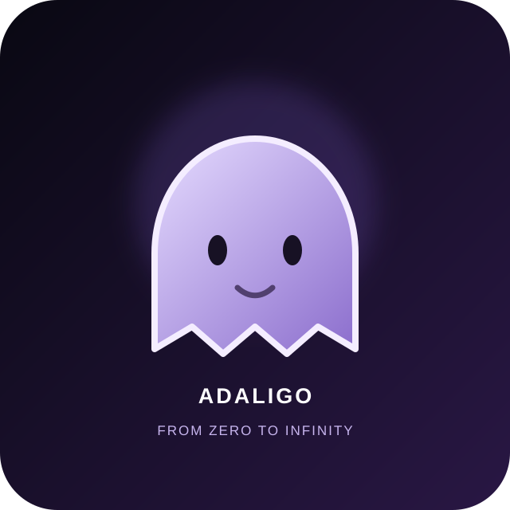
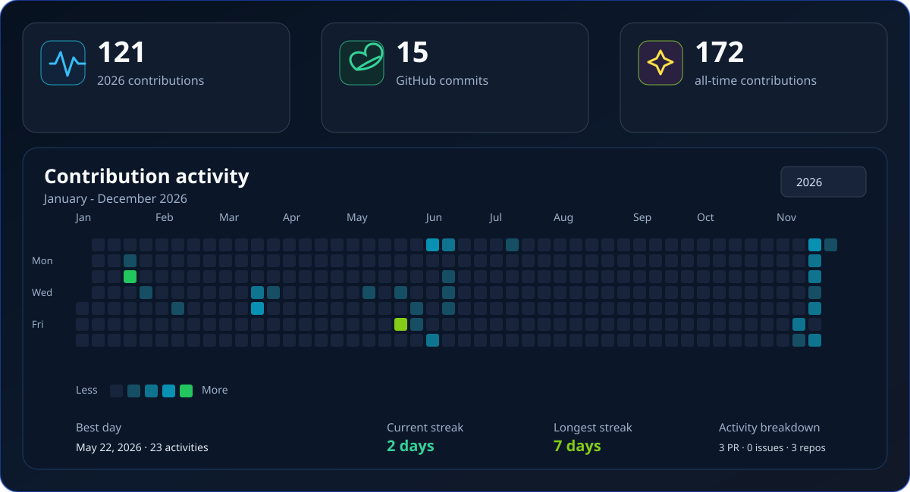

# ADALIGO — The Ghost Who Created It All

### From zero to infinity · The nightmare no one believed

<p align="center">
  
</p>

<p align="center">
  <a href="https://adaligo.github.io/">Website</a> ·
  <a href="https://github.com/ADALIGO">GitHub</a> ·
  <a href="https://github.com/ADALIGO/ADALIGO.github.io">Repository</a>
</p>

---

## 👻 The story

I am ADALIGO — the ghost who created it all, from zero to infinity.

This is a home for the ideas that begin in silence, grow through doubt, and become something real. The nightmare no one believed is only the beginning: a reminder to keep building when the vision is still invisible to everyone else.

**From nothing, a signal. From a signal, a world.**

## ✨ Inside this space

- **The story** — the ideas and moments behind the work.
- **The timeline** — reserved for future video stories and milestones.
- **The media placeholders** — ready for ADALIGO's own photos, videos, and audio.
- **The music player** — Marociasong, with playback position saved in this browser.
- **The code shelf** — language examples and starter projects.

## 🖼️ Add your media

The site currently uses neutral placeholders, not someone else's portrait or videos. Put ADALIGO-approved media in `public/media/`, then update `src/lib/portfolioVideos.ts` and the profile placeholder in `src/App.tsx` when ready.

## 🧰 Run locally

```bash
npm ci
npm run dev
```

Create a production build with `npm run build`.

## Installable app and offline use

On supported browsers, choose **Install this app** in Settings or use the
browser's **Add to Home Screen** option. After the first online visit, the
service worker caches the app shell and static assets; previously opened pages
can then load offline. Music selected in the player is stored privately in
that site's IndexedDB on the current device. Browsers with the File System
Access API use its audio picker; other browsers keep the standard file picker.
Push notifications need a backend and are not enabled yet.

## 📊 GitHub activity

<p align="center">
  <a href="https://github.com/ADALIGO">
    
  </a>
</p>

## 📊 Language showcase

<!-- language-metrics:start -->
| Language | Equal starter share | Measured source share | Files | File types | Starter |
|----------|---------------------|-----------------------|-------|------------|---------|
| 🦀 Rust | 12.5% | 1.1% | 1 | `.rs` | [Open](./starters/rust/README.md) |
| 🐹 Go | 12.5% | 1.0% | 2 | `.go` | [Open](./starters/go/README.md) |
| 🐍 Python | 12.5% | 2.3% | 4 | `.py` | [Open](./starters/python/README.md) |
| 🔷 TypeScript | 12.5% | 66.1% | 28 | `.ts, .tsx` | [Open](./starters/typescript/README.md) |
| ⚡ JavaScript | 12.5% | 1.0% | 4 | `.js, .mjs, .cjs` | [Open](./starters/javascript/README.md) |
| 🗃️ SQL | 12.5% | 0.8% | 5 | `.sql` | [Open](./starters/sql/README.md) |
| 🎨 CSS | 12.5% | 26.9% | 4 | `.css` | [Open](./starters/css/README.md) |
| 🌐 HTML | 12.5% | 0.8% | 2 | `.html, .htm` | [Open](./starters/html/README.md) |
<!-- language-metrics:end -->

## 🌌 The idea

This project is about making a space for a vision before the world can see it. One line, one page, one step at a time — from zero to infinity.

---

<p align="center">
  <strong>ADALIGO · The Ghost Who Created It All</strong><br />
  <em>The nightmare no one believed.</em>
</p>

<!-- Account verification: ADALIGO -->
